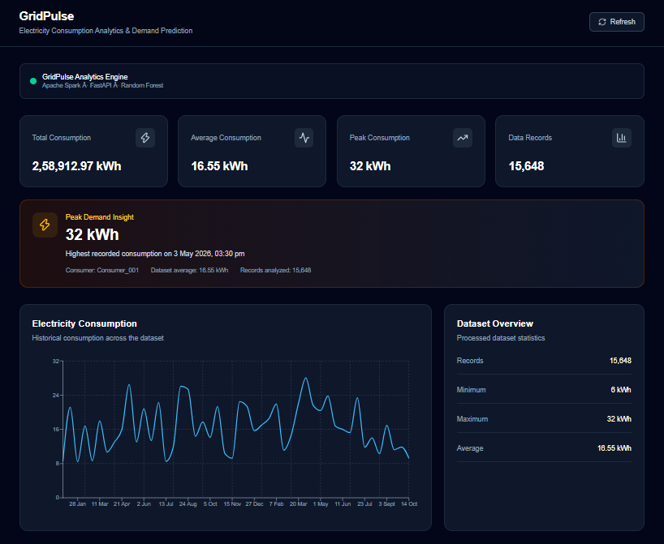
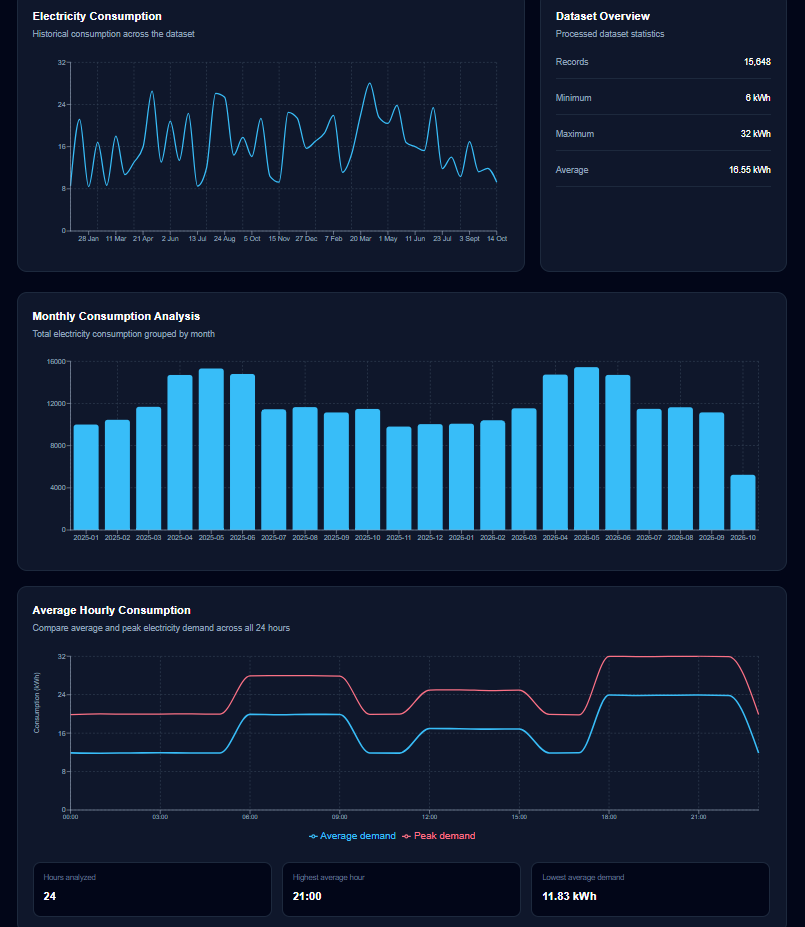
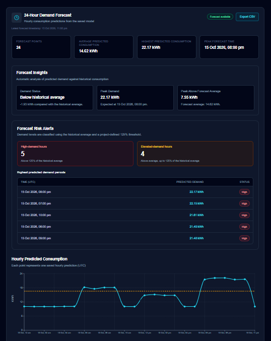
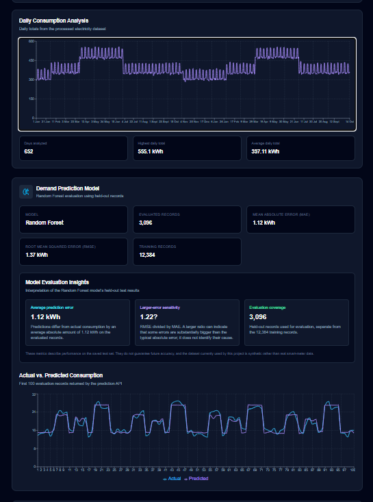
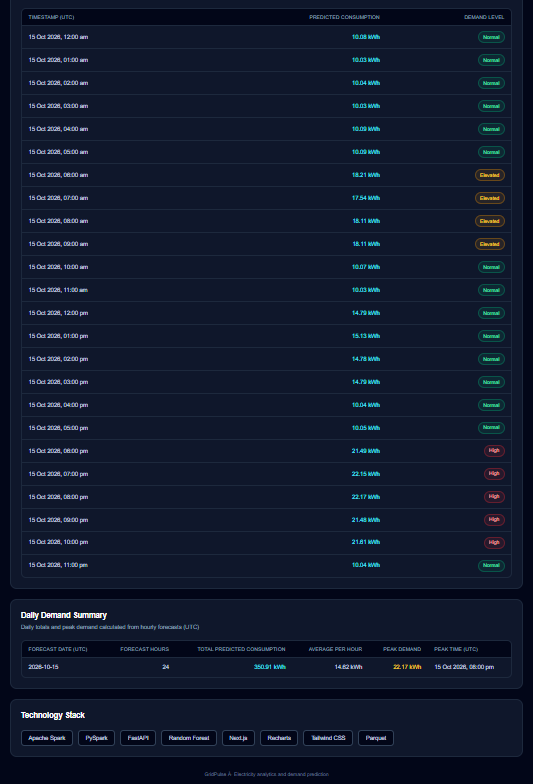

@'
# GridPulse ⚡
## Electricity Consumption Analytics and Demand Prediction

GridPulse is a Big Data Analytics project that analyzes hourly electricity consumption patterns and predicts demand for the next 24 hours using machine learning.

> **Dataset notice:** This project uses synthetically generated electricity consumption data for development and demonstration. It does not contain real smart-meter readings.

## Live Demo

- Frontend: https://grid-pulse-nine.vercel.app/
- Backend API: https://gridpulse-api-7odq.onrender.com
- API Health: https://gridpulse-api-7odq.onrender.com/api/health
- Interactive API Documentation: https://gridpulse-api-7odq.onrender.com/docs

## Dashboard Preview



### Consumption Analysis


### Demand Forecast


### Demand Prediction


### Demand Summary


## Features

- Electricity consumption summary statistics
- Consumption trend charts
- Daily, monthly, and hourly analytics
- Peak consumption analysis
- Random Forest regression for demand prediction
- Next-24-hours forecast
- Model evaluation using MAE, RMSE, and MAPE
- REST API using FastAPI
- Interactive dashboard using Next.js and TypeScript
- Cloud deployment using Render and Vercel

## Architecture

```text
Synthetic Electricity Dataset
            |
            v
    Data Processing
   Pandas / PySpark
            |
            v
      Parquet Data
            |
       +----+----+
       |         |
       v         v
   Analytics  Feature Engineering
                   |
                   v
           Random Forest Model
                   |
                   v
            24-Hour Forecast
       |                   |
       +---------+---------+
                 |
                 v
           FastAPI Backend
              (Render)
                 |
                 v
        Next.js Dashboard
              (Vercel)